  <h1>Vivek Kumar</h1>
  <h3>AI Engineer | Applied AI · Backend Systems · Infrastructure</h3>

  

    Building reliable AI-powered products — from application architecture and backend systems to intelligent workflows.
  

  
  
  
  
  

---

## About Me

I'm an **AI Engineer at Adnolgy**, building AI-powered products across product engineering, backend architecture, infrastructure, and applied AI.

I bring 4+ years of software engineering experience, primarily in backend development and distributed systems.

My approach to AI engineering is grounded in a simple idea:

**Building an AI demo is easy. Engineering a system that remains reliable when things fail is the real challenge.**

I work at the application engineering layer — integrating existing models into useful products and building the systems around them.

My interests include:

- Agentic AI and intelligent workflows
- Large Language Model applications
- Retrieval-Augmented Generation (RAG)
- LLM evaluation and observability
- AI application infrastructure
- Backend architecture and distributed systems
- System design and performance engineering

I care about the engineering details behind the product: concurrency, consistency, timeouts, retries, idempotency, observability, latency, and cost.

> AI systems have new failure modes. They also inherited all the old ones.

---

## Engineering Focus

| Domain | Areas of Interest |
|---|---|
| Applied AI | LLM applications, tool calling, agentic workflows, structured outputs |
| RAG & Evaluation | Hybrid retrieval, vector search, BM25, reranking, RAGAS |
| Backend Engineering | APIs, microservices, database design, domain boundaries |
| Distributed Systems | Concurrency, distributed locking, messaging, idempotency |
| AI Infrastructure | Model integration, tracing, evaluation pipelines, reliability |
| System Design | Scalability, availability, consistency, architecture trade-offs |

---

## Selected Engineering Projects

Projects where I focus on architecture, implementation details, and engineering trade-offs.

### 1. Airline Booking System — HLD + Runnable LLD

[Repository](https://github.com/Tenacious-Developer/Airline-Booking-System-Design-HLD-LLD)

A system design and runnable implementation of an airline booking platform, with particular emphasis on correctness under concurrent bookings.

**Engineering problems explored:**

- CQRS and read-optimized flight search.
- Transactional seat reservations using PostgreSQL row-level locking.
- Seat holds and idempotency keys.
- Asynchronous payment processing using the Saga pattern.
- Compensation and seat release when payment fails.
- Concurrency testing: two users compete for the last available seat; exactly one succeeds.

**Stack:** TypeScript · Node.js · PostgreSQL · System Design

### 2. Airbnb Backend — Distributed Microservices

[Repository](https://github.com/Tenacious-Developer/Airbnb_Backend_Microservices_Architecture)

A distributed backend architecture demonstrating independently deployable services and service-level ownership.

**Engineering problems explored:**

- Five microservices with independent business responsibilities and databases.
- Go-based API Gateway with authentication, authorization and rate limiting.
- JWT, RBAC and identity propagation across service boundaries.
- Redis distributed locking for inventory coordination.
- BullMQ-based asynchronous notification processing.
- Retry handling, service communication and database query optimization.

**Stack:** Go · Node.js · TypeScript · Redis · BullMQ · MySQL · Prisma · Sequelize

### 3. TaskFlow — Go Backend API

[Repository](https://github.com/Tenacious-Developer/taskflow-vivek-kumar)

A Go REST API built with a focus on clean architecture, explicit database operations and maintainability.

**Engineering problems explored:**

- Handler → Service → Repository architecture.
- Interface-based dependency injection.
- PostgreSQL schema design and versioned migrations.
- Transactional updates using SELECT FOR UPDATE.
- Compound indexes for filtered database queries.
- Dockerized local development and automated tests.

**Stack:** Go · PostgreSQL · sqlx · Docker · REST API

---

## Professional Experience

### AI Engineer — Adnolgy
*October 2026 – Present*

- Building AI-powered products across product scope, backend architecture, infrastructure and AI integration.
- Working on applied AI engineering and product development.
- Training engineers in practical AI engineering workflows and development practices.

### Software Development Engineer I — GeeksforGeeks
*September 2022 – September 2026*

- Built Docker-sandboxed code execution workflows using BullMQ queues, supporting 10,000+ learners.
- Addressed booking race conditions using Redis distributed locking and idempotency keys.
- Reduced API latency by **40%** through N+1 query elimination and database index redesign, at 500+ RPS.
- Developed asynchronous notification processing with dead-letter queues and exponential backoff, supporting 15,000+ users.
- Contributed to a mentorship platform serving 5,000+ concurrent users.

### Software Development Engineer Intern — GeeksforGeeks
*March 2022 – August 2022*

- Improved a Next.js quiz portal to 18,000+ monthly attempts, representing 40% growth.
- Migrated 60+ PHP pages to Next.js SSR, reducing page load time by 45%.

---

## 🛠️ Technical Toolkit

Technologies and tools I use to design, build, deploy, and operate reliable software and AI-powered systems.

### 🧠 AI & LLM Engineering

  
  
  
  
  

  
  
  
  
  
  
  
  
  
  

### 💻 Programming Languages

  

### ⚙️ Backend & API Engineering

  

### 🗄️ Databases & Storage

  

### 🔄 Distributed Systems & Messaging

  

  
  
  

### ☁️ Cloud, DevOps & Infrastructure

  

### 🧪 Developer Tools & Testing

  

  
  
  

---

## 📊 GitHub Engineering Activity

### GitHub Overview

  <picture>
    <source
      media="(prefers-color-scheme: dark)"
      srcset="./assets/overview.dark.svg"
    />
    
  </picture>

### Contribution Activity & Momentum

  <picture>
    <source
      media="(prefers-color-scheme: dark)"
      srcset="./assets/momentum.dark.svg"
    />
    
  </picture>

### Contribution Calendar & Streak

  <picture>
    <source
      media="(prefers-color-scheme: dark)"
      srcset="./assets/contributions.dark.svg"
    />
    
  </picture>

### Programming Language Distribution

  <picture>
    <source
      media="(prefers-color-scheme: dark)"
      srcset="./assets/languages.dark.svg"
    />
    
  </picture>

  <a href="https://github.com/Tenacious-Developer?tab=repositories">Explore Repositories</a>
  ·
  <a href="https://github.com/Tenacious-Developer?tab=activity">Recent Activity</a>
  ·
  <a href="https://github.com/Tenacious-Developer">GitHub Profile</a>

---

## Engineering Principles

- **Correctness before optimization:** Get consistency, transactions, and failure handling right before optimizing throughput.
- **Design for failure:** Account for timeouts, retries, duplicate requests, partial failures and recovery.
- **Measure before optimizing:** Use query analysis, latency metrics, and system behaviour to guide performance improvements.
- **Build with clear boundaries:** Prefer maintainable components, explicit contracts and documented architectural decisions.
- **Learn by building:** Turn engineering concepts into working implementations and document the trade-offs.

---

## Writing & Knowledge Sharing

I write about backend engineering, system design, distributed systems, and applied AI.

- [LinkedIn — Technical Notes & Engineering Insights](https://www.linkedin.com/in/vivek-kumar-tenacious/)
- [Hashnode — Technical Articles](https://hashnode.com/@TenaciousDeveloper)

---

  <h3>Build Fast → Break Fast → Fix Fast → Learn Fast</h3>

  <em>Tenacious Developer</em>

